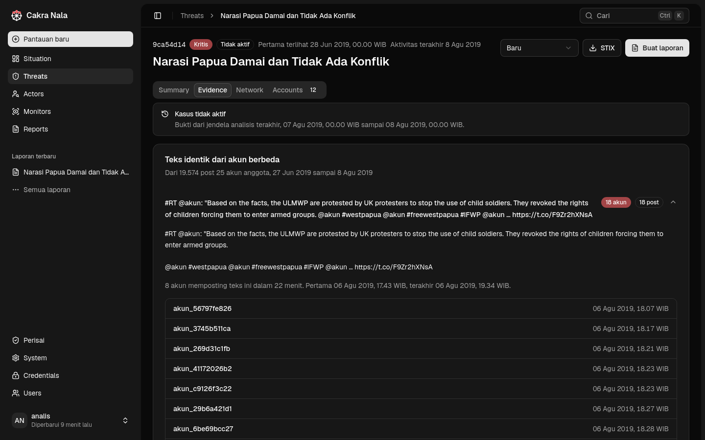

<div align="center">


# Cakra Nala

Deteksi operasi pengaruh terkoordinasi dari ketergantungan antar akun.

[](https://www.npmjs.com/package/cakranala)
[](LICENSE)
[](https://github.com/pajarori/cakranala/stargazers)
[](https://github.com/pajarori/cakranala/commits/main)

</div>

<p align="center">
  
</p>

Cakra Nala menemukan buzzer, bot farm dan swarm LLM dengan mengukur seberapa sering akun bergerak bersama melebihi peluang, lalu menghitung berapa suara independen yang sebenarnya ada di balik sebuah narasi. Tersedia sebagai library dan dashboard operasi untuk X, YouTube, Telegram, TikTok, Instagram dan Facebook. Cara kerjanya ada di [docs/how-it-works.md](docs/how-it-works.md).

## Instalasi

```bash
bun install -g cakranala
```

Butuh [Bun](https://bun.sh) 1.2 atau lebih baru. Untuk library saja: `npm install cakranala`.

## Pemakaian

```bash
# Siapkan model e5, Typst untuk PDF, dan Chrome untuk Instagram/Facebook
cakranala install

# Jalankan dashboard di http://localhost:3000
cakranala serve

# Dengan skenario demo Pulau Seruni
cakranala serve --demo

# Cek fitur yang siap
cakranala doctor
```

Sebagai library:

```js
import { analyze } from "cakranala";

const report = await analyze(dataset);
report.narratives.map((n) => [n.sample, n.supporters, n.sie.value]);
```

### Opsi

| Flag | Keterangan |
|---|---|
| `-p, --port` | Port dashboard (default: 3000) |
| `-d, --data` | Folder data (default: `./.cakranala`) |
| `--demo` | Putar skenario fiktif Pulau Seruni |

Kasus yang sudah dikonfirmasi bisa dilaporkan ke platform dan Komdigi dengan satu tombol, lihat bagian Aduan di [docs/platforms.md](docs/platforms.md).

Model bahasa diatur lewat `LLM_BASE_URL`, `LLM_MODEL` dan `LLM_API_KEY` (endpoint kompatibel OpenAI, opsional). Kredensial platform dan proxy diatur dari dashboard, lihat [docs/platforms.md](docs/platforms.md).

## Docker

```bash
docker compose up -d --build
```

## Lisensi

Apache License 2.0
